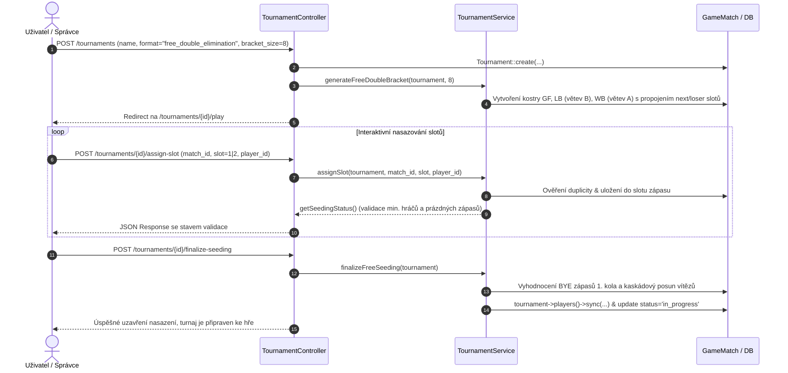
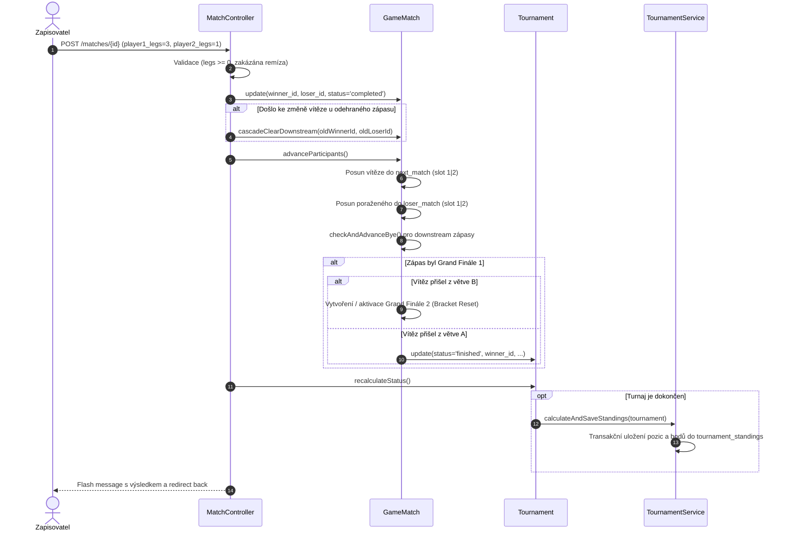

# Technická dokumentace systému Resulto

> **Verze:** 1.0  
> **Platforma:** PHP 8.2+ / Laravel 12.x  
> **Autor dokumentace:** Softwarový architekt & Technický dokumentátor  
> **Datum revize:** Říjen 2026  

---

## 1. Přehled projektu (Overview)

### 1.1 Účel projektu
**Resulto** je robustní webová aplikace určená pro kompletní správu, losování, interaktivní vedení a dlouhodobé statistické vyhodnocování šipkových turnajů (zejména disciplíny 501 Double Out, 301 apod.). 

Systém řeší klíčové výzvy turnajového managementu:
- Podporu komplexních vyřazovacích systémů včetně **Double Elimination** (opravný pavouk B a Grand Finále s možným Reset zápasem) a **FREE Elimination** (interaktivní nasazování hráčů do slotů v prázdné kostře pavouka o velikosti 8, 16 nebo 32 hráčů).
- Automatické kaskádové posuny hráčů (postup vítězů, pád poražených z větve A do větve B, ošetření volných losů – BYE bez falešných záznamů v opravném pavouku).
- Zápas o 3. a 4. místo u formátu **FREE Oneway Elimination**.
- Možnost zpětné editace výsledků zápasů s rekurzivním kaskádovým pročištěním navazujících větví (*downstream invalidation*).
- Dlouhodobý žebříček hráčů (**Leaderboard**) s filtrováním podle ročníků a All-Time historií, s oficiálním bodovacím klíčem a deduplikací hráčů.

### 1.2 Hlavní funkcionality
1. **Správa hráčů (Player Management):** CRUD operace, evidence pohlaví, vyhledávání s paginací, podpora AJAX API pro okamžité vytvoření hráče v modálním okně bez opuštění formuláře turnaje, automatický výpočet úspěšnosti (win rate).
2. **Generování a správa pavouků:**
   - *Double Elimination:* Automatické rozlosování hráčů, generování větve A (Winners), větve B (Losers) a Grand Finále.
   - *FREE Double Elimination & FREE Oneway Elimination:* Vytvoření prázdné kostry turnaje (8/16/32 pozic) s interaktivním obsazováním slotů, validací minimálního počtu hráčů a automatickým vyhodnocením volných losů (BYE).
3. **Zapisování výsledků (Match Scoring):** Vedení skóre v lezích, validace remíz (ve vyřazovacím pavouku nepřípustné), okamžité určení vítěze/poraženého, automatická aktualizace stavu turnaje.
4. **Kalkulace umístění a bodování (Standings & Ranking):** Transakční ukládání konečných pozic a bodů do tabulky `tournament_standings`.
5. **Dashboard a přehledy:** Medailová pódia ukončených turnajů, aktuálně běžící turnaje, připravené zápasy k odehrání a žebříček nejlepších hráčů.

### 1.3 Použité technologie a knihovny
- **Backend Framework:** Laravel 12.x
- **Programovací jazyk:** PHP 8.2+ (striktní typování, match výrazy, Eloquent ORM)
- **Databáze:** RDBMS kompatibilní s Eloquent (SQLite pro vývoj a testy, MySQL / MariaDB / PostgreSQL pro produkci) s plnou referenční integritou (`foreign keys`, `cascadeOnDelete`, `nullOnDelete`)
- **Frontend:** Laravel Blade šablony, responzivní Bootstrap layout, Vanilla JavaScript (Fetch API pro asynchronní operace nasazování slotů a rychlou editaci)
- **Nástroje a testování:** PHPUnit 11 (49 ucelených Feature a Unit testů s 539 asercemi pokrývajícími kompletní doménovou logiku pavouků, BYE i žebříčků)

---

## 2. Architektura a struktura

Aplikace využívá vrstvenou architekturu **MVC** doplněnou o **Servisní vrstvu (Service Layer)**, která izoluje doménovou logiku generování turnajů a kalkulace pořadí od HTTP kontrolerů.

```
+-------------------------------------------------------------------+
|                        Prezentační vrstva                         |
|  Blade šablony (layouts.app, tournaments.*, players.*, main)      |
|  Vanilla JS (Fetch API pro /assign-slot, /finalize-seeding)       |
+---------------------------------+---------------------------------+
                                  | HTTP Request / JSON Response
+---------------------------------v---------------------------------+
|                        Aplikační kontrolery                       |
|  TournamentController | MatchController | PlayerController        |
|  LeaderboardController | DashboardController | AuthController     |
+---------------------------------+---------------------------------+
                                  | Volání doménových operací
+---------------------------------v---------------------------------+
|                          Servisní vrstva                          |
|                     App\Services\TournamentService                |
|  - generateFreeDoubleBracket()    - calculateStandings()          |
|  - generateFreeOnewayBracket()    - calculateAndSaveStandings()   |
|  - assignSlot()                   - finalizeFreeSeeding()         |
+---------------------------------+---------------------------------+
                                  | Eloquent ORM dotazy & transakce
+---------------------------------v---------------------------------+
|                        Doménové modely                            |
|    Tournament | GameMatch | Player | TournamentStanding | User    |
+---------------------------------+---------------------------------+
                                  | SQL schéma
+---------------------------------v---------------------------------+
|                         Databázová vrstva                         |
|   tournaments | game_matches | players | tournament_players       |
|                 tournament_standings | users                      |
+-------------------------------------------------------------------+
```

### 2.1 Moduly a komponenty
1. **Modul Turnajů (`App\Http\Controllers\TournamentController`, `App\Models\Tournament`):**
   - Zodpovídá za životní cyklus turnaje: `draft` / `in_progress` / `ongoing` / `finished`.
   - Vede vazby na zúčastněné hráče (`tournament_players`), odehrané zápasy (`game_matches`) i medailisty (`winner_id`, `second_place_id`, `third_place_id`).
2. **Modul Zápasů (`App\Http\Controllers\MatchController`, `App\Models\GameMatch`):**
   - Reprezentuje jednotlivá utkání v rámci větví (`winners`, `losers`, `grand_final`, `third_place`).
   - Udržuje směrové ukazatele na další utkání: `next_match_id` (vítěz) a `loser_match_id` (poražený).
   - Implementuje rekurzivní algoritmus pročištění navazujících větví při zpětné změně výsledku.
3. **Servisní modul Turnajů (`App\Services\TournamentService`):**
   - Čistá doménová logika: generování grafu pavouka, validace nasazení, propagace volných losů (BYE) a výpočet konečných pořadí podle pravidel jednotlivých formátů.
4. **Modul Hráčů a Žebříčku (`PlayerController`, `LeaderboardController`, `Player`, `TournamentStanding`):**
   - Agreguje statistiky a bodové zisky hráčů v čase s možností ročníkového filtrování a All-Time žebříčku.

---

### 2.2 Datový tok (Data Flow)

#### A. Vytvoření a nasazení turnaje (FREE Elimination)


#### B. Zápis výsledku zápasu a kaskádový postup


---

## 3. Detailní popis modulů, tříd a funkcí

### 3.1 `App\Services\TournamentService`
Třída zapouzdřující veškeré algoritmické výpočty pavouků a vyhodnocování umístění.

#### `calculateStandings(Tournament $tournament): array`
- **Účel:** Vypočítá konečné umístění všech hráčů turnaje podle zvoleného formátu.
- **Parametry:**
  - `Tournament $tournament`: Instance turnaje s načtenými relacemi zápasů a hráčů.
- **Návratová hodnota:** `array` – Pole asociativních polí s klíči:
  - `rank` (`string`): Textová reprezentace, např. `"1."`, `"3."`, `"5.–6."`.
  - `rank_num` (`int`): Počáteční numerické pořadí (pro řazení).
  - `rank_from` (`int`): Spodní hranice rozsahu umístění.
  - `rank_to` (`int`): Horní hranice rozsahu umístění.
  - `points` (`int`): Přidělené body do žebříčku.
  - `player` (`Player`): Instance modelu hráče.
  - `player_name` (`string`): Jméno hráče.
- **Výjimky:** Nevyvolává; deleguje na specializované chráněné metody podle `$tournament->format`.

#### `calculateFreeOnewayStandings(Tournament $tournament): array` *(protected)*
- **Účel:** Spočítá pořadí pro jednozápasový KO pavouk s povinným zápasem o 3. a 4. místo.
  - 1. místo: Vítěz finále.
  - 2. místo: Poražený z finále.
  - 3. místo: Vítěz zápasu o 3. místo.
  - 4. místo: Poražený ze zápasu o 3. místo.
  - 5.–8., 9.–16. atd.: Poražení z předchozích kol (pouze reální hráči, ignorují se BYE).

#### `calculateDoubleEliminationStandings(Tournament $tournament): array` *(protected)*
- **Účel:** Spočítá pořadí pro Double Elimination:
  - 1. místo: Vítěz Grand Finále (GF1 nebo rozhodujícího GF2).
  - 2. místo: Poražený z Grand Finále.
  - 3. místo: Poražený z finále větve B (Losers Final).
  - 4. místo: Poražený ze semifinále větve B.
  - Dělené pozice (5.–6., 7.–8., 9.–12., ...): Hráči vyřazení v odpovídajících kolech větve B.

#### `calculateKnockoutStandings(Tournament $tournament): array` *(protected)*
- **Účel:** Spočítá pořadí pro klasický Single Elimination pavouk bez zápasu o 3. místo (semifinalisté dělí 3.–4. místo).

#### `calculateAndSaveStandings(Tournament $tournament): Collection`
- **Účel:** Vypočítá a atomicky uloží konečné pořadí a body do tabulky `tournament_standings` uvnitř databázové transakce (`DB::transaction`). Pro neeliminační formáty (`groups`, `round_robin`) vrací prázdnou kolekci.
- **Parametry:**
  - `Tournament $tournament`: Cílový turnaj.
- **Návratová hodnota:** `Illuminate\Database\Eloquent\Collection<TournamentStanding>` – Uložené entity umístění s eager-loaded relací `player`.

#### `generateFreeOnewayBracket(Tournament $tournament, int $size): void`
- **Účel:** Vytvoří prázdný skelet pavouka FREE Oneway o velikosti $2^K$ (8, 16 nebo 32 pozic) s předpřipraveným zápasem o 3. a 4. místo. Propojí postupové cesty vítězů mezi koly a poražené ze semifinále nasměruje do zápasu o bronz.
- **Parametry:**
  - `Tournament $tournament`: Model nově vytvořeného turnaje.
  - `int $size`: Velikost pavouka (8, 16, 32; při neplatné hodnotě se použije default 8).

#### `generateFreeDoubleBracket(Tournament $tournament, int $size): void`
- **Účel:** Vytvoří kompletní skelet pavouka Double Elimination o velikosti $N \in \{8, 16, 32\}$:
  1. Grand Finále: GF1 a podmíněný GF2 (Reset zápas).
  2. Losers Bracket (B): $L = 2 \times (K - 1)$ kol, kde $K = \log_2(N)$.
  3. Winners Bracket (A): $K$ kol.
  4. Nasměrování poražených: Z 1. kola větve A do 1. kola větve B; z mezilehlých kol větve A do sudých kol větve B křížem (aby se předešlo okamžité odvetě); z finále větve A do finále větve B.
- **Parametry:**
  - `Tournament $tournament`: Turnaj.
  - `int $size`: 8, 16 nebo 32.

#### `assignSlot(Tournament $tournament, int $matchId, int $slot, int|string|null $playerId): array`
- **Účel:** Obsadí nebo uvolní slot v zápase 1. kola větve A. Podporuje předání ID existujícího hráče, jména nového hráče (vytvoří se přes `firstOrCreate`) nebo `null` pro vymazání slotu.
- **Parametry:**
  - `Tournament $tournament`: Cílový turnaj.
  - `int $matchId`: ID zápasu 1. kola.
  - `int $slot`: Číslo slotu (1 nebo 2).
  - `int|string|null $playerId`: ID hráče, textové jméno, nebo null.
- **Návratová hodnota:** `array` – Výsledek z `getSeedingStatus($tournament)`.
- **Výjimky:**
  - `\InvalidArgumentException`: Pokud turnaj není typu FREE, nasazení je již uzavřeno, slot není 1 ani 2, hráč nebyl nalezen nebo je již nasazen v jiném slotu téhož turnaje.

#### `getSeedingStatus(Tournament $tournament): array`
- **Účel:** Ověří v reálném čase validační pravidla pro uzavření nasazení.
- **Parametry:**
  - `Tournament $tournament`: Turnaj.
- **Návratová hodnota:** `array` obsahující:
  - `bracket_size` (`int`), `min_players` (`int`), `assigned_count` (`int`), `assigned_player_ids` (`array`), `empty_matches_count` (`int`), `can_finalize` (`bool`), `errors` (`array<string>`).
- **Validační pravidla:**
  - Počet nasazených hráčů $\ge \frac{\text{size}}{2} + 1$ (např. min. 5 pro pavouk o 8, min. 9 pro 16, min. 17 pro 32).
  - Žádný zápas 1. kola nesmí mít oba sloty prázdné (`empty_matches_count === 0`).

#### `finalizeFreeSeeding(Tournament $tournament): array`
- **Účel:** Uzavře nasazení, vyhodnotí zápasy s jedním hráčem jako automatickou výhru (BYE), posune vítěze do 2. kola, propojí hráče v pivot tabulce `tournament_players`, rekurzivně vyřeší kaskádové BYE v navazujících kolech a přepne stav na `in_progress`.
- **Návratová hodnota:** `array{success: bool, message: string}`.
- **Výjimky:**
  - `\InvalidArgumentException`: Pokud podmínky pro uzavření nejsou splněny.

---

### 3.2 Model `App\Models\Tournament`
Reprezentuje turnaj a jeho konfiguraci.

#### Hlavní atributy a přetypování (`$casts`):
- `name` (`string`), `date` (`date`), `status` (`draft`, `in_progress`, `ongoing`, `finished`).
- `format` (`string`): `'free_oneway_elimination'`, `'free_double_elimination'`, `'double_elimination'`, `'knockout'`.
- `counts_for_ranking` (`bool`): Určuje, zda se výsledky započítávají do žebříčku.
- `season_year` (`int`): Sezóna / ročník turnaje.
- `bracket_size` (`int`): Kapacita pavouka (8, 16, 32).
- `is_seeding_finalized` (`bool`): Příznak uzamčení slotů.
- `best_of_legs` (`int`): Počet hraných legů.

#### Klíčové metody:
- `recalculateStatus(): void`: Analyzuje stav všech zápasů. Pokud je odehráno finále (či Grand Finále vč. resetu a zápasu o 3. místo), nastaví `status = 'finished'`, dosadí `winner_id`, `second_place_id`, `third_place_id` a zavolá `calculateAndSaveStandings()`. Pokud došlo k resetování klíčového zápasu, vrátí status na `in_progress` / `ongoing`, smaže umístění z tabulky `tournament_standings` a vynuluje medailisty.
- `generateDoubleEliminationMatches(array $playerIds): void`: Algoritmus pro automatické rozlosování standardního Double Elimination pavouka s rovnoměrnou distribucí volných losů (BYE).
- `calculateThirdPlace(): ?Player`: Vyhledá poraženého z finále větve B.
- `scopeCountedForRanking($query)` a `scopeForSeason($query, int $year)`: Eloquent scopes pro filtrování.

---

### 3.3 Model `App\Models\GameMatch`
Reprezentuje konkrétní zápas a implementuje grafovou logiku pavouka.

#### Klíčové atributy:
- `bracket_type`: `'winners'` (A), `'losers'` (B), `'grand_final'`, `'third_place'`.
- `next_match_id` & `next_match_slot`: Ukazatel na zápas a slot (1 nebo 2) pro vítěze.
- `loser_match_id` & `loser_match_slot`: Ukazatel na zápas a slot pro poraženého.
- `is_reset_match` (`bool`): Určuje, zda se jedná o podmíněné Grand Finále 2.
- `is_bye` (`bool`): Označuje automatický postup bez soupeře.

#### Klíčové metody:
- `isSlotPermanentBye(int $slot): bool`: Zjišťuje, zda je daný slot trvale prázdný, protože jeho feeder zápas byl BYE (nevyprodukoval poraženého nebo vítěze) nebo nemá feeder v 1. kole.
- `checkAndAdvanceBye(): void`: Pokud je jeden slot obsazen a druhý je permanentní BYE, automaticky označí zápas jako `completed` (`is_bye = true`) a posune hráče dále. Pokud jsou oba sloty BYE, uzavře zápas bez vítěze a propaguje se dále.
- `advanceParticipants(): void`: Posune vítěze do `next_match_id` a poraženého do `loser_match_id` (pouze pokud skutečně existuje reálný poražený – volný los nikdy negeneruje falešného poraženého do opravného pavouka). V Grand Finále 1 vyhodnotí, zda vítěz z větve B vynutil Grand Finále 2 (Bracket Reset).
- `cascadeClearDownstream(?int $oldWinnerId, ?int $oldLoserId): void`: Rekurzivně projde všechny navazující zápasy ve větvích vítěze i poraženého, vymaže reference na staré hráče, vrátí stav navazujících zápasů na `scheduled`, vynuluje skóre a vyčistí případný Reset zápas v Grand Finále.

---

### 3.4 Model `App\Models\Player`
- **Atributy:** `name`, `gender` (`male`, `female`).
- **Počítané atributy (Accessors):**
  - `total_points`: Celkový počet bodů získaných v započítávaných turnajích.
  - `tournaments_played_count`: Počet odehraných hodnocených turnajů.
  - `matches_count`: Celkový počet odehraných zápasů.
  - `wins_count`: Počet vyhraných zápasů.
  - `win_rate`: Procentuální úspěšnost zaokrouhlená na 1 desetinné místo.
  - `gender_label`: Překlad pohlaví (`"Muž"` / `"Žena"`).

---

### 3.5 Model `App\Models\TournamentStanding`
Ukládá vypočítané pořadí hráče v turnaji.

#### Statická metoda: `calculatePoints(int $rankFrom, int $rankTo): int`
Implementuje oficiální bodovací škálu:
$$\text{Body} = \begin{cases} 
10 & \text{pro 1. místo} \\
9 & \text{pro 2. místo} \\
8 & \text{pro 3. místo (pokud } rankTo = 3\text{)} \\
7 & \text{pro 4. místo (nebo dělené 3.–4.)} \\
6 & \text{pro 5.–6. místo (příp. 5.–8.)} \\
5 & \text{pro 7.–8. místo} \\
4 & \text{pro 9.–12. místo} \\
3 & \text{pro 13.–16. místo} \\
2 & \text{pro 17.–24. místo} \\
1 & \text{pro 25.–32. místo} 
\end{cases}$$

---

### 3.6 Kontrolery (Controllers)

#### `TournamentController`
- `index()`: Paginovaný seznam turnajů s počtem zápasů a medailisty.
- `create()`: Formulář pro vytvoření turnaje se seznamem hráčů.
- `store(Request $request)`: Vytvoří turnaj. Pro FREE formáty vygeneruje prázdnou kostru přes `TournamentService`, pro klasický Double Elimination náhodně rozlosuje vybrané hráče.
- `assignSlot(Request $request, Tournament $tournament)`: AJAX endpoint pro obsazení/uvolnění slotu (`match_id`, `slot`, `player_id`).
- `finalizeSeeding(Request $request, Tournament $tournament)`: Endpoint pro uzavření nasazení a start turnaje.
- `play(Tournament $tournament)` / `show(Tournament $tournament)`: Zobrazení interaktivního pavouka turnaje rozděleného na větev A, větev B a Grand Finále.
- `update(Request $request, Tournament $tournament)`: Úprava názvu, data, ročníku či počtu legů.
- `destroy(Tournament $tournament)`: Smazání turnaje a kaskádové odstranění zápasů.

#### `MatchController`
- `update(Request $request, GameMatch $match)`: Zápis výsledku legů (`player1_legs`, `player2_legs`). Ošetřuje:
  - Reset zápasu na 0:0 $\rightarrow$ zavolá `cascadeClearDownstream()`.
  - Zakázání remízy ve vyřazovacím pavouku.
  - Změnu vítěze u již odehraného zápasu $\rightarrow$ kaskádové pročištění staré větve a posun nového vítěze.
  - Přepočet stavu turnaje přes `tournament->recalculateStatus()`.

#### `LeaderboardController`
- `index(Request $request)`: Dlouhodobý žebříček hráčů.
  - Podporuje query parametr `?season=2026` nebo `?season=all_time`.
  - Dynamicky načítá dostupné ročníky ze započítávaných turnajů.
  - Sdružuje hráče podle ID a provádí case-insensitive deduplikaci podle jména.

#### `PlayerController`
- Standardní RESTful CRUD pro správu hráčů s podporou AJAX odpovědí (HTTP 201 Created / 200 OK) pro okamžitou registraci z UI.

#### `AuthController`
- Zajišťuje autentizaci: `showLogin()`, `login()`, `showRegister()`, `register()`, `logout()`.

---

## 4. Konfigurace a prostředí

### 4.1 Požadavky na prostředí (System Requirements)
- **PHP:** $\ge 8.2$ s rozšířeními `pdo`, `pdo_sqlite` (nebo `pdo_mysql`), `mbstring`, `openssl`, `tokenizer`, `xml`, `ctype`, `json`, `curl`.
- **Composer:** verze 2.x
- **Node.js & NPM:** Node.js 18+ a NPM pro kompilaci frontendových assetů (Vite).
- **Webový server:** Apache (s povoleným `mod_rewrite`), Nginx nebo vestavěný PHP server.

### 4.2 Proměnné prostředí (`.env`)
Aplikace vychází z `.env.example`. Klíčové proměnné:

| Proměnná | Výchozí hodnota | Popis |
| :--- | :--- | :--- |
| `APP_NAME` | `Resulto` / `Laravel` | Název aplikace zobrazovaný v záhlaví |
| `APP_ENV` | `local` | Prostředí (`local`, `production`) |
| `APP_KEY` | *(generováno)* | Šifrovací klíč aplikace (`php artisan key:generate`) |
| `APP_DEBUG` | `true` | Zobrazení ladicích informací (na produkci nastavit `false`) |
| `APP_URL` | `http://localhost` | Kořenová URL adresa |
| `DB_CONNECTION` | `sqlite` | Ovladač databáze (`sqlite`, `mysql`, `pgsql`) |
| `DB_DATABASE` | `database/database.sqlite` | Cesta k souboru SQLite databáze nebo název DB |
| `SESSION_DRIVER` | `database` | Úložiště sessions (používá tabulku `sessions`) |

### 4.3 Postup instalace a spuštění

```bash
# 1. Klonování repozitáře a přechod do adresáře
git clone <url-repozitare> resulto
cd resulto

# 2. Instalace PHP závislostí
composer install

# 3. Příprava konfiguračního souboru a vygenerování klíče
copy .env.example .env
php artisan key:generate

# 4. Příprava databáze a migrace se seedem výchozích dat
# (Vytvoří administrátora admin@darts.cz / password, hráče a demo turnaj)
touch database/database.sqlite
php artisan migrate --seed

# 5. Instalace JavaScript závislostí a sestavení assetů
npm install
npm run build

# 6. Spuštění lokálního vývojového serveru
php artisan serve
```
Aplikace je následně dostupná na `http://127.0.0.1:8000`.

### 4.4 Spuštění testovací sady
```bash
php artisan test
```
Všech 49 automatizovaných testů ověřuje celou funkčnost od načítání stránek přes rozlosování Double Elimination až po specifické větvení volných losů a přepočet žebříčku.

---

## 5. Bezpečnost a edge-cases

### 5.1 Ošetřené hraniční stavy (Edge Cases)

1. **Volné losy (BYE) v Double Elimination:**
   - Pokud v 1. kole větve A nastoupí hráč proti BYE, postoupí do 2. kola. Do větve B (Losers Bracket) se **nesmí propadnout žádný poražený**. Kód v `GameMatch::advanceParticipants()` striktně kontroluje `$this->loser_id`, čímž zamezuje vzniku duchů a prázdných utkání v opravném pavouku.
2. **Kaskádové volné losy (Cascading BYE Resolution):**
   - V případě, že do zápasu ve větvi B dorazí pouze jeden hráč a protější pozice měla vzejít z větve, která skončila volným losem, metoda `checkAndAdvanceBye()` automaticky detekuje trvalý BYE (`isSlotPermanentBye()`) a posune hráče dále bez nutnosti manuálního zásahu obsluhy.
3. **Grand Finále a Bracket Reset:**
   - Hráč postupující z větve A nemá na svém kontě žádnou porážku, zatímco hráč z větve B má již jednu porážku. Pokud vyhraje hráč z větve A, turnaj okamžitě končí. Pokud vyhraje hráč z větve B, aktivuje se podmíněný zápas `is_reset_match = true` (Grand Finále 2), kde oba hráči disponují jednou porážkou.
4. **Zpětná změna výsledku (Downstream Invalidation):**
   - Pokud obsluha opraví překlep ve skóre již dříve odehraného zápasu (nebo jej resetuje na 0:0), metoda `cascadeClearDownstream()` rekurzivně projde všechny navazující zápasy, ve kterých figurovali původní vítěz nebo poražený, vymaže je ze slotů, vrátí stav zápasů na `scheduled` a přepočítá stav celého turnaje.
5. **Zákaz remízy:**
   - `MatchController` aktivně brání uložení nerozhodného skóre (např. 2:2) ve vyřazovacích zápasech, což by zablokovalo postupový graf.
6. **Validace nasazení v FREE turnaji:**
   - `TournamentService::getSeedingStatus()` odmítne uzavřít nasazení, pokud je celkový počet hráčů menší než polovina velikosti pavouka + 1, nebo pokud by v 1. kole zůstal jakýkoliv zápas zcela neobsazený (oba sloty prázdné).
7. **Deduplikace hráčů v žebříčku:**
   - `LeaderboardController` a databázová migrace řeší situaci, kdy by se v databázi vyskytli hráči se stejným jménem (např. z důvodu manuálního zadání bez vazby na existující ID), sloučením jejich bodů na základě normalizovaného jména (`mb_strtolower(trim($name))`).

---

### 5.2 Možná slabá místa a bezpečnostní doporučení

#### 1. Autentizace a autorizace mutačních endpointů
- **Slabé místo:** V `routes/web.php` nejsou modifikační routy (`/tournaments`, `/matches/{match}`, `/players`) chráněny middlewarem `auth`. Přestože systém obsahuje plně funkční `AuthController`, administrátorské akce jsou přístupné i nepřihlášeným uživatelům.
- **Doporučení:** Obalit mutační a editační endpointy do routovací skupiny s `auth` middlewarem:
  ```php
  Route::middleware(['auth'])->group(function () {
      Route::post('/tournaments', [TournamentController::class, 'store'])->name('tournaments.store');
      Route::match(['put', 'post'], '/matches/{match}', [MatchController::class, 'update'])->name('matches.update');
      Route::delete('/tournaments/{tournament}', [TournamentController::class, 'destroy'])->name('tournaments.destroy');
      // Další modifikační routy...
  });
  ```

#### 2. Transakční integrita při zápisu výsledků
- **Slabé místo:** Metoda `MatchController::update` provádí aktualizaci zápasu, volání `cascadeClearDownstream`, `advanceParticipants` a `tournament->recalculateStatus` v několika samostatných SQL dotazech mimo explicitní `DB::transaction`. Pokud by během postupu došlo k výpadku nebo chybě, databáze by mohla zůstat v nekonzistentním mezistavu.
- **Doporučení:** Obalit celou logiku v `MatchController::update` do `DB::transaction(...)`.

#### 3. Oddělení validační logiky do FormRequest tříd
- **Slabé místo:** Validace vstupů se nachází přímo v tělech metod kontrolerů (`$request->validate([...])`), což zbytečně zvětšuje kontrolery.
- **Doporučení:** Vytvořit dedikované třídy požadavků:
  - `App\Http\Requests\StoreTournamentRequest`
  - `App\Http\Requests\UpdateMatchRequest`
  - `App\Http\Requests\AssignSlotRequest`

#### 4. Vyčištění nepotřebného kódu
- **Nález:** Kontroler `app/Http/Controllers/UserController.php` obsahuje pouze cvičnou metodu `addUser()` vracející text `"Hello beroski"`.
- **Doporučení:** Soubor `UserController.php` bezpečně odstranit z projektu.

---

## 6. Praktické ukázky použití (Code Snippets)

### 6.1 Vytvoření turnaje FREE Double Elimination s velikostí pavouka 16
```php
use App\Models\Tournament;
use App\Services\TournamentService;

// 1. Založení turnaje
$tournament = Tournament::create([
    'name' => 'Letní šipkový pohár 2026',
    'date' => '2026-07-15',
    'status' => 'in_progress',
    'format' => 'free_double_elimination',
    'bracket_size' => 16,
    'counts_for_ranking' => true,
    'season_year' => 2026,
    'best_of_legs' => 5,
]);

// 2. Vygenerování prázdné kostry pavouka (větev A, větev B, Grand Finále)
$tournamentService = new TournamentService();
$tournamentService->generateFreeDoubleBracket($tournament, 16);
```

### 6.2 Interaktivní nasazení hráčů a uzavření nasazení
```php
// Nasazení existujícího hráče (ID 12) do 1. kola, zápasu č. 1, slotu 1
$tournamentService->assignSlot($tournament, $firstMatchId, 1, 12);

// Nasazení nového hráče podle jména (automaticky vytvoří záznam v players)
$tournamentService->assignSlot($tournament, $firstMatchId, 2, 'Petr Novák');

// Kontrola připravenosti k uzavření nasazení
$status = $tournamentService->getSeedingStatus($tournament);
if ($status['can_finalize']) {
    // Uzavření nasazení, vyhodnocení BYE a zahájení turnaje
    $result = $tournamentService->finalizeFreeSeeding($tournament);
    echo $result['message'];
} else {
    print_r($status['errors']);
}
```

### 6.3 Zápis výsledku zápasu a automatický postup
```php
use App\Models\GameMatch;

$match = GameMatch::findOrFail($matchId);

// Luke Littler (slot 1) vítězí nad soupeřem 3:1
$match->update([
    'player1_legs' => 3,
    'player2_legs' => 1,
    'winner_id' => $match->player1_id,
    'loser_id' => $match->player2_id,
    'status' => 'completed',
]);

// Automatický posun vítěze v pavouku a propad poraženého do opravné větve
$match->advanceParticipants();

// Aktualizace stavu celého turnaje (vč. výpočtu konečných pozic a bodů při finále)
$match->tournament->recalculateStatus();
```

---
*Konec technické dokumentace systému Resulto.*
